<em>"Quem pensa em fracassar, já fracassou mesmo antes de tentar."</em>

 

<picture><source media="(prefers-color-scheme: dark)" srcset="https://github-readme-stats.vercel.app/api/top-langs?username=Plovatto&locale=pt-br&layout=compact&card_width=320&langs_count=6&theme=radical&hide_border=true&border_radius=10" /></picture><picture><source media="(prefers-color-scheme: dark)" srcset="https://streak-stats.demolab.com?user=Plovatto&locale=pt-br&mode=weekly&theme=radical&hide_border=true&border_radius=10" /></picture>

<picture><source media="(prefers-color-scheme: dark)" srcset="assets/icons-dark.svg" /></picture> 
<picture><source media="(prefers-color-scheme: dark)" srcset="https://raw.githubusercontent.com/Plovatto/Plovatto/output/panda-dark.svg" /></picture>

  
  
  
  

